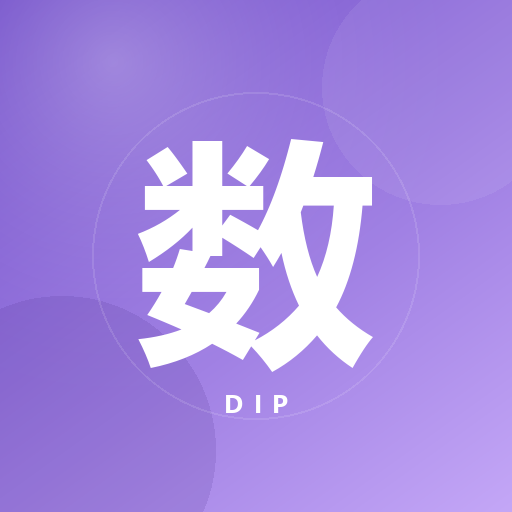
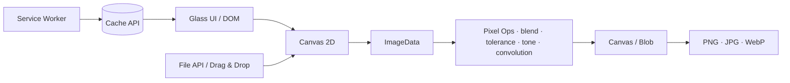

<div align="center">



# 黄同学的数图通关秘籍

### DIP Toolbox · Digital Image Processing, but make it healing.

**一个纯前端、零依赖、所有像素都在浏览器里完成的数字图像处理工具箱。**

<p>
  
  
  
  
</p>
<p>
  
  
  
  
</p>

> **TL;DR** — 打开即用，不登录、不上传、不追踪。  
> 7 张工具卡，把数字图像处理的作业、PS 快捷键和配色灵感，全部装进一块香芋紫色的屏幕里。

`01` Features · `02` Stack · `03` Quick Start · `04` PWA · `05` Disclaimer

</div>

---

```text
$ cat /proc/dip-toolbox/status
runtime      : browser
backend      : null
dependencies : 0
uploads      : 0
telemetry    : 0
vibe         : taro purple
build        : handcrafted
```

---

## ✦ 这是什么 / What is this?

《黄同学的数图通关秘籍》是一份**私人定制的数字图像处理学习工具箱**，也是一个可以直接安装到手机主屏幕的 **PWA**。

它把课堂上容易听睡着的概念——通道、直方图、混合模式、容差、卷积核、空域滤波——全部做成了可以上手拖拽、点击、对比的交互实验。没有后端，没有框架，没有 `node_modules`，也没有一张图片会离开你的浏览器。

> 核心 UI 是一个单文件 `index.html`；PWA 只额外增加了 `manifest.json`、`sw.js` 和一组图标。

---

## ✦ 屏幕 / Screens

> 390px 移动端 viewport · 香芋紫毛玻璃 · 所有像素在本地完成

| 压缩 · Before/After · 直方图 | 图层混合实验室 |
|:---:|:---:|
|  |  |

| 图像空域滤波 | 保姆级通关指南 |
|:---:|:---:|
|  |  |

---

## ✦ 功能矩阵 / The Seven Modules

> **7 张工具卡，一张不多，一张不少。**  
> 第 01 张卡内置了独立的 **RGB 直方图**，所以“压缩 + 直方图”算作同一个模块；剩下六张分别是取色、混合、抠图、调色、滤波和渐变。

| # | Module | 你能得到什么 | 核心实现 |
|:---:|:---|:---|:---|
| **01** | **图片压缩 / 格式转换 + RGB 直方图** | 拖入图片，拖动白色分割线对比原图与压缩图；调质量导出 JPG / WebP；下方实时显示 R/G/B 通道分布 | `canvas.toBlob` · `getImageData` · 256-bin histogram · 5-bin smoothing · `pow(0.58)` 压缩视觉比例 |
| **02** | **图片取色器** | 点击图片任意位置，立刻读取 HEX / RGB，一键复制进 PS 或代码 | 长边 1600px 离屏 Canvas · 指针坐标映射 · `getImageData` |
| **03** | **图层混合实验室** | 上传底图与上层图，切换正片叠底 / 滤色 / 叠加 / 正常，直观看到“去白留黑” | `globalCompositeOperation` · contain 等比缩放 · 1600px 上限 |
| **04** | **容差抠图模拟器** | 点击背景色，拖容差滑块，相近颜色实时变透明，露出棋盘格 | RGB 欧氏距离 · 阈值 `tolerance / 100 × √3 × 255` · alpha 置 0 · rAF 节流 |
| **05** | **高级色彩调校** | R / G / B 三通道独立 -100 ~ +100，实时像素加减，支持一键重置 | `source[i] + shift` · `Uint8ClampedArray` 自动 clamp · 1000px 预览上限 |
| **06** | **图像空域滤波** | 3×3 均值滤波平滑去噪；拉普拉斯锐化增强边缘；可下载 PNG 结果 | 600px 离屏 Canvas · 3×3 邻域平均 · 拉普拉斯核 `[0,-1,0; -1,5,-1; 0,-1,0]` · `try-catch` 全流程 |
| **07** | **极简 CSS 渐变生成器** | 两个颜色 + 一个角度，实时预览，点击复制完整 CSS | `linear-gradient()` · Clipboard API · 实时 input 同步 |

### 还有这些，不止是工具箱

| Extra | Detail |
|:---|:---|
| ⌨️ **30 个 PS 高频快捷键** | 按“图层 / 选区 / 调整 / 工具”分组，支持全局实时搜索，点击卡片一键复制 |
| 🖼️ **格式对照表** | JPG、PNG、WebP 的优缺点与适用场景，极简对照 |
| 🎨 **神仙配色库** | 赛博朋克、日系清新、复古港风三组配色，点击复制全部 Hex |
| 📖 **保姆级通关指南** | 原生 `<details>` 折叠面板，按“什么时候用 / 具体怎么点”拆解 7 个工具 |
| ⏳ **交作业倒计时** | 可编辑截止时间，实时跳动，`localStorage` 持久化 |
| 📈 **作业进度条** | 每次 +10%，本地保存，刷新不丢 |
| 🥚 **隐藏彩蛋** | 连续点击顶部问候语 5 次，会有一个只属于黄同学的惊喜 |
| 📱 **PWA 离线安装** | 添加到主屏幕，全屏启动，断网也能打开 |

---

## ✦ 设计语言 / Taro Purple, Softly

这是一个**不像实验报告的数图项目**。视觉方向只有一句话：

> 像一本高级备忘录，也像一块在凌晨三点还亮着的紫色屏幕。

```css
/* 设计语言示意，不是运行时主题文件 */
:root {
  --taro-50:  #f5f0ff;   /* 背景与呼吸感 */
  --taro-100: #efe8ff;   /* 卡片与弱高亮 */
  --taro-500: #7c5bd6;   /* 主色 / 主题色 */
  --taro-700: #5c3eb0;   /* 标题与强调 */
  --ink:      #30283d;   /* 深灰字体 */
  --radius:   16px;      /* 大圆角 */
}
```

- **16px 大圆角 + 极柔和阴影**，卡片像浮在薰衣草色空气里
- **香芋紫 → 纯白渐变**，不是高饱和赛博朋克，而是低刺激的治愈感
- **毛玻璃 Tabs**：`backdrop-filter: blur(20px) saturate(1.45)`
- **移动端优先**：320px 不横向溢出，390px 是主要设计基准
- **系统字体**：不加载外部字体，首屏不等待网络
- **触控细节**：`env(safe-area-inset-*)`、`-webkit-tap-highlight-color`、`touch-action: manipulation`

---

## ✦ 技术栈 / Under the Hood

| Layer | Choice | Why |
|:---|:---|:---|
| **UI** | Semantic HTML + CSS Custom Properties | 零框架、可移植、一个文件就能跑 |
| **Pixel Engine** | Canvas 2D · `ImageData` · `Uint8ClampedArray` | 真正的逐像素数学，不是 CSS `filter` 糊弄 |
| **State** | `localStorage` | 倒计时、作业进度，本地持久化 |
| **Offline** | Service Worker + Cache API | Cache First，断网也能打开 |
| **PWA** | Web App Manifest + PNG/SVG icons | 主屏幕安装、standalone、maskable |
| **Input** | File API · Drag & Drop · Pointer Events | 手机相册、桌面拖拽都顺手 |
| **Export** | `Blob` · `URL.createObjectURL` · `<a download>` | 纯前端下载，无服务端 |
| **QA** | Edge Headless + Chrome DevTools Protocol | 真机尺寸、真实点击、无头回归 |
| **Build** | **None.** | 没有构建步骤，就是故意的 |

### Architecture



### Performance Boundaries

| Pipeline | Limit | Reason |
|:---|:---:|:---|
| 图片压缩输入 | **25 MB / 24 MP** | 避免移动端内存爆炸 |
| 压缩质量 | **10–100** | JPG / WebP 编码质量 |
| 高级色彩调校 | 长边 **1000px** | 滑块实时预览，避免每帧处理超大图 |
| 图像空域滤波 | 长边 **600px** | 3×3 卷积在手机上也要保持跟手 |
| 图层混合 / 容差抠图 / 取色器 | 长边 **1600px** | 清晰度与性能的平衡点 |
| PWA 预缓存 | **8 个 URL** | 页面、清单、全部图标 |

---

## ✦ 快速开始 / Quick Start

### 1. 克隆

```bash
git clone <your-repo-url> dip-toolbox
cd dip-toolbox
```

### 2. 启动一个本地静态服务器

```bash
# Python 3
python3 -m http.server 8000

# Windows 上也可以
python -m http.server 8000
```

### 3. 打开

```text
http://localhost:8000/
```

> **不要直接双击 `index.html`。**  
> `file://` 不是安全上下文，Service Worker 不会注册，PWA 也不会工作。

### 4. 部署

这是一个纯静态项目，直接放到任意支持 HTTPS 的静态托管即可：

- GitHub Pages
- Netlify
- Vercel
- Cloudflare Pages
- 自己的 Nginx / Caddy

确保以下文件在**同一层根目录**：

```text
.
├── index.html
├── manifest.json
├── sw.js
├── icons/
│   ├── icon.svg
│   ├── icon-192.png
│   ├── icon-512.png
│   ├── icon-maskable-512.png
│   └── apple-touch-icon.png
├── README.md
└── preview-*.png
```

`manifest.json` 和 `sw.js` 必须在根作用域，否则 PWA 的 `scope` 和缓存会失效。

---

## ✦ PWA / Install It Like an App

### Android · Chrome

1. 用 Chrome 打开部署好的 HTTPS 地址
2. 右上角菜单 → **“安装应用” / “添加到主屏幕”**
3. 桌面出现紫底白“数”的专属图标
4. 点开即进入 `standalone` 模式，没有地址栏

### iPhone · Safari

1. 用 Safari 打开页面
2. 分享按钮 → **“添加到主屏幕”**
3. 从主屏幕启动，使用 `apple-touch-icon.png` 作为图标

### Offline

Service Worker 采用 **Cache First**：

```text
页面请求 → Cache 命中？ → 直接返回缓存
                    ↓ 否
                 网络请求 → 成功则写入缓存
                    ↓ 失败且是导航请求
                 回退到缓存的 index.html
```

更新页面后，记得把 `sw.js` 里的缓存版本号 +1：

```js
const CACHE_NAME = "huang-shutu-pwa-v2";
```

---

## ✦ 隐私 / Zero Upload

> **你的照片从未离开浏览器。**

- 没有后端
- 没有登录
- 没有埋点
- 没有 Cookie
- 没有外部字体请求
- 没有把图片上传到任何服务器

所有 `drawImage`、`getImageData`、`putImageData`、`toBlob` 都发生在本地 Canvas 里。PWA 缓存也只缓存应用自身的静态资源。

---

## ✦ 已验证 / QA Matrix

这不是“感觉能跑”，是真机尺寸跑过：

| Check | Result |
|:---|:---|
| 390px / 320px 横向溢出 | `scrollWidth === innerWidth` |
| 7 张工具卡 | 全部存在，320px 下右边距 308px |
| 3 个 Tab | 查询百科 / 进阶实操 / 急救与灵感 |
| 30 个快捷键 | 搜索、复制、空状态正常 |
| 压缩 + 直方图 | 前后对比、质量切换、256-bin 分布正常 |
| 色彩调校 | R+40 / G−20 / B+10 → `[91, 82, 163, 255]`；重置回原图 |
| 空域滤波 | 均值边缘 144；拉普拉斯边缘 255；PNG 下载正常 |
| PWA | `installabilityErrors: []`，SW active，缓存 8 项 |
| 离线 | 断网导航仍能加载标题与 7 张工具卡 |
| Console | `pageErrors: []` / `consoleErrors: []` |

> 测试环境：Microsoft Edge Headless + CDP，本地静态服务器，移动端 viewport 模拟。

---

## ✦ 已知边界 / Known Limits

- 需要现代浏览器：Canvas 2D、`backdrop-filter`、Service Worker
- PWA 安装依赖 **HTTPS** 或 `localhost`
- iOS 的离线行为取决于 Safari 版本；主屏幕安装本身可用
- 超大图会按上表的上限缩放预览，这是性能取舍，不是像素丢失
- 项目没有构建、没有 npm 包、没有 CI —— **这是 feature，不是 TODO**

---

## ✦ 彩蛋 / Classified

<details>
<summary>⚠️ CLASSIFIED // 点击查看彩蛋坐标</summary>

连续点击页面顶部那个 **“下午好，黄同学”** 的问候标签 **5 次**。

剩下的，自己看。

</details>

---

<div align="center">

## ⚠️ 免责声明 / A Love Letter, Not a Product

> 这不是一个普通开源项目。  
> 它是一封用 Canvas 写的情书，是一块在凌晨三点还亮着的紫色屏幕，是某个人把“数图作业”偷偷做成“通关秘籍”的证据。
>
> **本项目为作者私人定制礼物，仅供展示，未经允许请勿商用或盗用。**
>
> 如果你在别人的仓库里看到它，请替我记得：  
> 紫色不是随手调的，彩蛋不是随手埋的，  
> 而那行 `// Mastered by ZJJ. Handcrafted for the one and only ARMY.`  
> 也不是随手写的。

<br />

`// Mastered by ZJJ. Handcrafted for the one and only ARMY.`

<sub>Made with taro purple, raw pixels, and a little bit of stubbornness.</sub>

</div>
